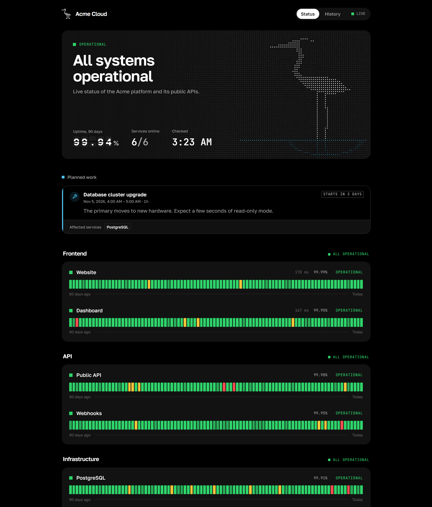
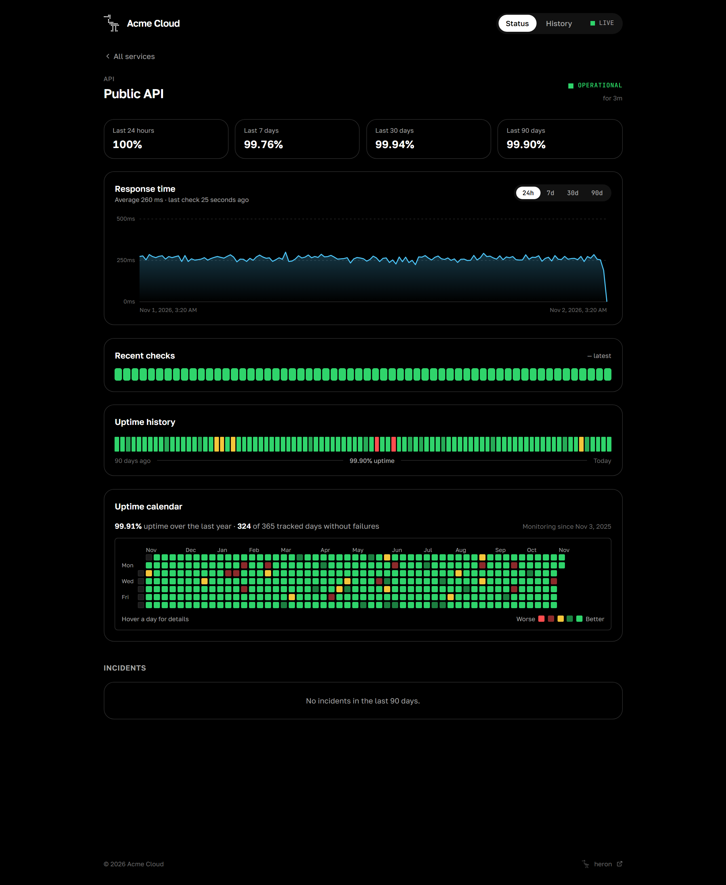
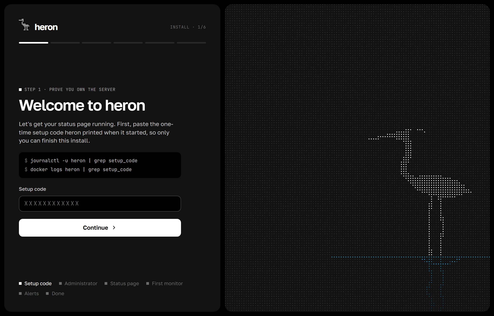

<p align="center">
  <picture>
    <source media="(prefers-color-scheme: dark)" srcset="docs/logo-dark.svg">
    
  </picture>
</p>

<p align="center">
  A self-hosted status page and uptime monitor.<br>
  One small binary, one SQLite file, and a page your users will actually like looking at.
</p>

<p align="center">
  <a href="https://github.com/nethercode/heron/actions/workflows/ci.yml"></a>
  <a href="https://github.com/nethercode/heron/releases"></a>
  <a href="LICENSE"></a>
</p>

<p align="center">
  
</p>

## Why heron

I wanted a status page that I could drop on a cheap VPS and forget about. Most tools I tried either needed a database server, ate a few hundred megabytes of RAM, or looked like an admin template from 2014. heron is my answer to that.

It checks your sites, APIs, databases, containers and game servers, keeps a year of history, opens incidents when something breaks and closes them when it comes back. The public page updates live, so people watching it during an outage see the moment things recover.

## What it does

**Checks.** HTTP and HTTPS with status codes, keywords, custom headers and certificate expiry. TCP ports, ping and DNS records. Postgres (it runs a real query), Redis, SMTP with STARTTLS, IMAP, Docker containers and their healthchecks, gRPC health, Minecraft and Steam servers with player counts. Push monitors for cron jobs and backups that call heron instead of the other way around.

**Status page.** 90 day uptime bars, a GitHub style calendar for the whole year, response time charts and an incident timeline. Live updates over Server-Sent Events, no refresh needed.

**Incidents and maintenance.** Incidents open and resolve on their own, and you can write updates by hand. Maintenance windows can be one-off or repeat every day or week. While one is running, alerts stay quiet and the page tells visitors what is going on.

**Alerts.** Telegram (topics in forum groups work too) and signed webhooks, with retries. A monitor only counts as down after the number of failed checks you choose, so a single hiccup does not wake you up.

**Extras.** SVG badges for your README, a small script that shows a notice on your own website during an outage, and a dark admin panel that matches the public page.

<p align="center">
  
</p>

## Getting it running

You need a Linux server and, ideally, a domain or subdomain pointed at it with an A record.

```sh
curl -fsSL https://raw.githubusercontent.com/nethercode/heron/main/deploy/install.sh | sudo sh
```

The script downloads the latest release, checks its checksum, creates a `heron` system user and starts the service. At the end it prints a one-time setup code. Open `http://your-server:8080` and the installer takes it from there.

<p align="center">
  
</p>

The installer walks you through seven short steps:

1. **Setup code.** Proves you are the one who owns the server, so nobody can grab a fresh install before you do.
2. **Domain.** Enter something like `status.example.com`. heron checks that the record points at the server, gets a certificate from Let's Encrypt, starts serving HTTPS on ports 80 and 443 and moves you over to the new address. If you already run nginx or Caddy, pick the reverse proxy option and heron will only remember the address.
3. **Administrator.** Your username and password.
4. **Status page.** Title, description and an optional logo.
5. **First monitor.** Any URL you care about.
6. **Alerts.** A Telegram bot token and chat. heron sends a test message straight away.
7. **Done.**

Everything except the setup code and the account can be skipped and changed later in the panel.

Lost the code? It is in the log:

```sh
journalctl -u heron | grep setup_code
```

### Docker

```sh
docker run -d --name heron \
  -p 80:80 -p 443:443 -p 8080:8080 \
  --sysctl net.ipv4.ip_unprivileged_port_start=0 \
  --cap-add NET_RAW \
  -v heron-data:/data \
  ghcr.io/nethercode/heron:latest

docker logs heron | grep setup_code
```

There is also a [`compose.yaml`](compose.yaml) in the repository.

### From source

You need Go 1.27 or newer, Node 24 or newer and pnpm.

```sh
git clone https://github.com/nethercode/heron && cd heron
cd web && pnpm install && pnpm build && cd ..
go build ./cmd/heron
./heron serve
```

If you have [Task](https://taskfile.dev) installed, `task build` does the same.

## Configuration

Most things are set in the panel. The few that belong to the server live in `heron.toml` (next to the binary, in `$HERON_CONFIG`, or passed with `-config`). Every key can also come from an environment variable.

| Key               | Variable                | Default  | What it does                                                    |
| ----------------- | ----------------------- | -------- | --------------------------------------------------------------- |
| `listen`          | `HERON_LISTEN`          | `:8080`  | Address for plain HTTP, handy for local access and proxies      |
| `data_dir`        | `HERON_DATA_DIR`        | `./data` | Where the database and certificates are stored                  |
| `public_url`      | `HERON_PUBLIC_URL`      |          | Address used in alerts when no domain is set in the panel       |
| `timezone`        | `HERON_TIMEZONE`        | `UTC`    | Which midnight the daily uptime bars use                        |
| `retention_days`  | `HERON_RETENTION_DAYS`  | `7`      | How long raw checks are kept. Hourly totals stay for a year     |
| `trusted_proxies` | `HERON_TRUSTED_PROXIES` |          | Proxies allowed to set `X-Forwarded-For`                        |
| `icmp_privileged` | `HERON_ICMP_PRIVILEGED` | `false`  | Use raw sockets for ping, needs `CAP_NET_RAW`                    |
| `log_level`       | `HERON_LOG_LEVEL`       | `info`   | `debug`, `info`, `warn` or `error`                              |
| `log_format`      | `HERON_LOG_FORMAT`      | `text`   | `text` or `json`                                                |

There is an example in [`heron.example.toml`](heron.example.toml).

### Behind your own proxy

Point the proxy at port 8080, turn off buffering so live updates get through, and add the proxy to `trusted_proxies` so login limits apply per visitor and not to everyone at once.

```nginx
location / {
    proxy_pass http://127.0.0.1:8080;
    proxy_set_header Host $host;
    proxy_set_header X-Forwarded-For $proxy_add_x_forwarded_for;
    proxy_buffering off;
}
```

With Caddy it is a single line: `reverse_proxy 127.0.0.1:8080`.

## Push monitors

Create a monitor of type Push and heron gives you a URL. Call it at the end of your job:

```sh
0 3 * * * /usr/local/bin/backup.sh && curl -fsS -m 10 --retry 3 https://status.example.com/api/push/<token>
```

If no call arrives within the interval plus a grace period, the monitor goes down. A job can also report a failure or its own timing:

```
/api/push/<token>?status=down&msg=disk%20full
/api/push/<token>?status=up&ping=532
```

## Badges and the widget

```markdown
[](https://status.example.com)
[](https://status.example.com/monitor/api)
```

Use `/badge/<slug>` for a single monitor, `/badge/<slug>/uptime?period=24h|7d|30d|90d` for uptime and `/badge/<slug>/response` for the last response time. Add `?label=` to change the text on the left.

The widget stays hidden while everything is fine and shows a small card on your site when something is wrong or maintenance is running:

```html
<script src="https://status.example.com/widget.js" data-position="bottom-right" async></script>
```

You can move it with `data-position`, announce planned work early with `data-upcoming="true"` and change how often it refreshes with `data-refresh` (in seconds).

## Webhooks

Webhook channels receive a JSON `POST` every time a monitor goes down or comes back:

```json
{
  "event": "monitor.down",
  "at": "2026-11-02T03:14:00Z",
  "status": "down",
  "reason": "unexpected status 502 Bad Gateway",
  "link": "https://status.example.com/monitor/api",
  "monitor": { "id": 3, "slug": "api", "name": "API", "kind": "http", "target": "https://api.example.com/health" }
}
```

If you set a secret, each request also carries `X-Heron-Timestamp` and `X-Heron-Signature: sha256=<hex>`, an HMAC of `timestamp + "." + body`.

## Docker monitors

These talk to the Docker API, by default through `/var/run/docker.sock`. Add the `heron` user to the `docker` group, or put a read-only socket proxy in front and set the monitor's Docker host to `tcp://proxy:2375`.

## Command line

```
heron serve                 start the server
heron user create -u name   create an administrator without the installer
heron user passwd -u name   reset a password and sign out every session
heron version               print the version
```

## Working on heron

```sh
task dev     # backend on :8080 and the Vite dev server on :5173
task test    # go test -race ./...
task lint    # golangci-lint, svelte-check and biome
```

The Go code lives in `internal/`. `monitor` has the checks, `scheduler` runs one goroutine per monitor, `engine` turns results into incidents, alerts and live events, `site` handles domains and certificates, and `store` wraps SQLite. The interface is a SvelteKit app in `web/` that gets built to static files and embedded into the binary.

## License

[MIT](LICENSE)
